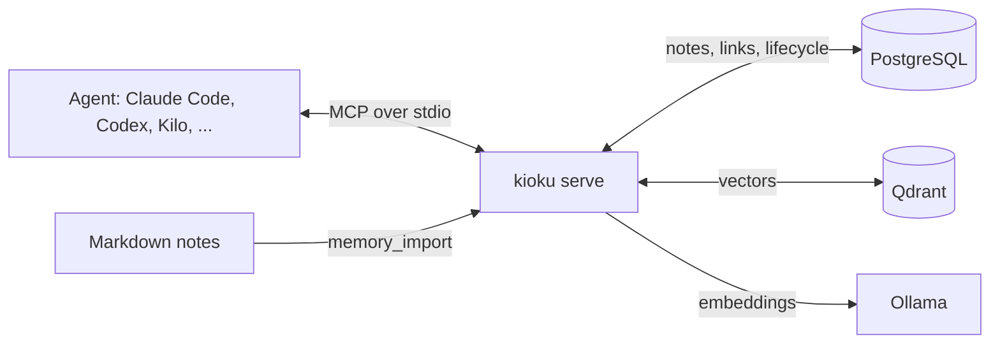

# Kioku (記憶)

[](https://github.com/Jpgomesf/kioku/actions/workflows/ci.yml)

Long-term memory for coding agents, served over [MCP](https://modelcontextprotocol.io).
Kioku keeps curated notes (decisions, architecture, conventions, verified fixes,
preferences) and lets any agent find and read just the ones a task needs,
instead of re-reading a whole docs folder every session.

- **Hybrid retrieval with a link graph.** Embeddings and BM25 are fused with
  Reciprocal Rank Fusion; explicit links between notes pull in related context
  without pushing direct matches down. Exact keys, titles, and aliases always
  win.
- **Works with any model.** The same server serves a quantized local model and
  frontier models through Claude Code, Codex, Kilo, Gemini CLI, Cursor, or any
  stdio MCP client: three core tools, flat schemas, keys instead of UUIDs,
  lenient arguments, and actionable errors. See [docs/clients.md](docs/clients.md).
- **Measured, not assumed.** `kioku eval` scores retrieval on graded queries;
  behavior checks score what agents actually do. See
  [docs/evaluation.md](docs/evaluation.md).
- **Local and inspectable.** PostgreSQL holds the notes, Qdrant the vectors,
  Ollama computes embeddings. Notes can live as Markdown files you edit and
  review. Nothing is ever hard-deleted, and the server runs no language model.



## Quick start

Requirements: Docker with Compose, a Rust toolchain (1.94 or newer), and
Python 3 (used once to generate credentials).

```sh
git clone https://github.com/Jpgomesf/kioku && cd kioku
make start     # PostgreSQL, Qdrant, Ollama on loopback ports; creates a private .env
make install   # builds bin/kioku
./bin/kioku doctor
./bin/kioku ingest --path examples/notes --domain demo
./bin/kioku search "Which service replaces the old indexing worker?" --domain demo
```

`make start` writes `.env` (mode 0600) with unique credentials on first run and
never evaluates it as shell code. The services bind to 127.0.0.1 only:

| Service | Address | Volume |
|---|---|---|
| PostgreSQL | `127.0.0.1:15432` | `local-memory_postgres_data` |
| Qdrant | `http://127.0.0.1:16333` | `local-memory_qdrant_data` |
| Ollama | `http://127.0.0.1:11435` | `local-memory_ollama_models` |

`make stop` stops them and keeps the volumes. Back up PostgreSQL together with
your notes; the Qdrant index is derived data that `kioku repair --all` rebuilds.

### Embeddings on the Apple GPU

Docker on macOS can't use the GPU, so the bundled Ollama container embeds on
the CPU. That's fine for everyday saves, but importing thousands of notes keeps
every core busy for minutes. An Ollama installed on the Mac itself runs on the
GPU:

```sh
brew install ollama && brew services start ollama
# in .env:
EMBEDDING_URL=http://127.0.0.1:11434
make start               # now starts only PostgreSQL and Qdrant, and pulls the model natively
make stop-docker-ollama  # the container is no longer used
```

`ollama ps` should show `100% GPU`. The vector index stays valid: it depends
on the model and prompts, not on where they run, and the same model gives the
same vectors (cosine similarity above 0.9999 between the two runtimes).

### Hosted embeddings

To run no embedding model at all, use a hosted service with an
OpenAI-compatible `/embeddings` endpoint, such as
[OpenRouter](https://openrouter.ai/collections/embedding-models) or OpenAI:

```sh
# in .env
EMBEDDING_PROVIDER=openai                      # the API's shape, whoever serves it
EMBEDDING_URL=https://openrouter.ai/api/v1     # or https://api.openai.com/v1
EMBEDDING_MODEL=openai/text-embedding-3-small  # OpenRouter's name for it; OpenAI's is text-embedding-3-small
EMBEDDING_DIM=1536                             # the model's vector size
EMBEDDING_API_KEY=...
ALLOW_REMOTE_EMBEDDINGS=true
EMBEDDING_READER=openai                        # who reads the text you send; see below
```

`make start` then starts only PostgreSQL and Qdrant. Kioku picks query and
document prompts from the model's name (`qwen/qwen3-embedding-8b` gets
Qwen3's), and a wrong `EMBEDDING_DIM` stops the first embedding with a clear
error. An install that already has an index moves in three steps: copy
`.env` to `hosted.env` and change the embedding settings and
`QDRANT_COLLECTION` there; compare the model on the bundled retrieval set
with `./bin/kioku --env-file hosted.env eval`; then run
`./bin/kioku reindex --to-env-file hosted.env`, which embeds every note again
before switching, and make `hosted.env` your `.env`.

**What the service may read.** The service reads every text it embeds, so
Kioku treats it like a model of the provider named in `EMBEDDING_READER`:
`local` by default for an address on this machine, `other` for any other.
Through OpenRouter the text passes both OpenRouter and the model's host, so
name the host's provider only if you trust both.

- A service read only locally (`local`) receives every note, as before.
- Any other receives a note only if that provider may read it. Without
  vaults, a note whose `lock` leaves the provider out is kept from it. With
  vaults, the note's vault must list the provider, no area lock may leave it
  out, and the note's own lock, if any, must name it.
- A note kept from the service has no vector. Search finds it by keyword,
  label, and link, with its keyword rank standing in for the meaning rank it
  can't have; `memory_inspect` marks it `not_sent_to_embedder`, and imports
  and `kioku repair` count such notes.
- Queries go to the service too, unless it may read none of the domains
  searched.
- After changing which providers a vault lists, or its locks, run
  `./bin/kioku repair --all`: it embeds the notes the service may now read
  and removes the vectors of those it no longer may.

## Connect a client

Every client launches [`scripts/mcp.sh`](scripts/mcp.sh), which runs
`bin/kioku serve` with this checkout's `.env`. Use the absolute path:

```sh
# Claude Code
claude mcp add --scope user kioku -- /absolute/path/to/kioku/scripts/mcp.sh

# Codex CLI / IDE / app
codex mcp add kioku -- /absolute/path/to/kioku/scripts/mcp.sh
```

Kilo (`~/.config/kilo/kilo.jsonc`):

```json
{"mcp": {"kioku": {"type": "local", "command": ["/absolute/path/to/kioku/scripts/mcp.sh"], "enabled": true}}}
```

Then tell agents which memory domain belongs to each project, in its
`AGENTS.md` or `CLAUDE.md`:

```markdown
The Kioku memory domain for this project is `my-project`.
```

With vaults, skip that line: the instructions name the session's vault
instead (see [Vaults and locks](#vaults-and-locks)).

The server's instructions carry the usage policy to every client, so no
client-specific prompt files are needed. [docs/clients.md](docs/clients.md)
covers more clients, tool profiles, and tuning for small local models.

## Tools

The default `core` profile exposes three tools; `MEMORY_TOOLS=all` (or
`scripts/mcp.sh --tools all`) adds the rest, and a list such as
`core,memory_import` picks individual tools.

| Tool | Profile | What it does |
|---|---|---|
| `memory_search` | core | Ranked previews (key, title, snippet, score) for a question |
| `memory_get` | core | Full text of chosen memories by key, with links, within a byte budget |
| `memory_save` | core | Create or update one memory by key; refuses credentials and file-backed notes |
| `memory_inspect` | all | Provenance, lifecycle, usage, links, and recent history of one memory |
| `memory_feedback` | all | Record that a memory proved right or wrong |
| `memory_retire` / `memory_restore` | all | Move a memory to legacy and back; nothing is deleted |
| `memory_import` | all | Import Markdown notes from `MEMORY_NOTES_ROOT` |
| `memory_maintenance` | all | Preview or apply monthly aging |
| `memory_stats` | all | Counts by status and domain, index health |

Two prompts, `recall` and `remember`, give users explicit shortcuts in clients
that support MCP prompts. Tools from earlier versions (`rag_search`,
`rag_context`, `memory_upsert`, ...) are still accepted under their old names.

## Notes

A note is one focused fact with a stable key. Markdown notes use YAML
frontmatter; editing the file and importing it again updates the same memory:

```markdown
---
key: jobs-worker
title: Jobs worker owns background indexing
domain: my-project
aliases: [indexing worker, worker de indexação]
related: [local-stack, batch-worker-retirement]
tags: [service, indexing]
confidence: 0.9
pinned: false
---

The jobs-worker is the current owner of background document indexing.
It replaces the retired batch-worker.
```

- `related` links resolve within the domain by key, then title, then alias;
  `[[wiki links]]` work. Missing or ambiguous references are reported.
- `lock: local` (or a list of providers) limits which models may read the
  note. It takes effect with a vaults file; see
  [Vaults and locks](#vaults-and-locks). A `lock` that lists no provider
  (`lock: []`, `lock:`), or a near miss such as `Lock`, `locks`, or `locked`,
  fails the file instead of importing the note unlocked.
- Saving a key again replaces its text, but nothing is lost: every save,
  edit, retirement, and restore appends the note's content and status to
  `memory_note_revisions`, and `memory_inspect` lists the ten latest entries.
- Import with `memory_import` (paths stay inside `MEMORY_NOTES_ROOT`) or
  `kioku ingest --path DIR --domain DOMAIN`. A file's path is its provenance;
  agents can't overwrite file-backed notes through `memory_save`.
- A file that can't be imported (unreadable, bad frontmatter, another domain,
  a key another file or source owns, too long to embed) is skipped and listed
  under `failed` with the reason; the other files import. Only when every
  file fails is the import an error, and then nothing is written. With
  vaults, a session's `memory_import` lists only failures of notes it may
  see; the rest are counted in `failed_count` but not named (see
  [Vaults and locks](#vaults-and-locks)).
- Each note must fit the embedding model's context window (about 6 KB of
  English text for `nomic-embed-text`); `memory_save` rejects a longer note
  before anything is saved, with a request to split it.

### Open Knowledge Format bundles

`kioku ingest` reads an [Open Knowledge Format](https://github.com/GoogleCloudPlatform/open-knowledge-format)
(OKF v0.2) bundle as it is, with no converted copy. A folder whose `index.md`
declares `okf_version` is read as a bundle (`--format okf` forces it):

```sh
kioku ingest --path ~/work/company-kb --domain company/kb
```

- **Keys.** Each concept becomes a note keyed by its concept ID, the file's
  path in the bundle without `.md` (`kb/decisions/DEC-350-links`). A
  producer `id` and `aliases` become aliases, so `memory_get DEC-350` works.
  The source is the concept's own file, so a re-import after `git pull`
  re-embeds only what changed.
- **Links.** Bundle-relative (`/kb/x.md`) and relative links become `related`
  links. In the stored text a link keeps its words, plus the target's id when
  they lack it. A list item that is only links becomes a list of ids. Links to
  concepts the bundle lacks are kept as words and counted, as the spec asks.
  `index.md` and `log.md` are skipped: the graph replaces them.
- **Long concepts.** A concept over 4,000 bytes becomes a hub note and one note
  per section, keyed `<concept ID>#<anchor>` with GitHub's heading anchor, so
  a link to `/kb/architecture.md#router` reaches the section about the router.
  Sections split at their headings, then by paragraph and table row (tables
  keep their header).
- **Facts line.** A concept's note (or hub) opens with its type and id, its
  lifecycle, the trust tier `verified` gives (unverified, machine-confirmed,
  human-reviewed), `stale_after`, the producer's other plain fields (a
  decision's status and who made it, say), who wrote it, and its `resource`.
  A section opens with a shorter line: type and id, the concept it belongs
  to, lifecycle, trust, and `stale_after`. Trust also sets the note's
  confidence. Profile fields need no setup in Kioku.
- **Lifecycle.** The bundle decides: concepts with `status: deprecated` are
  legacy notes, the rest are active, and a note whose concept or section left
  the bundle (or a bundle moved since its last import) becomes legacy too,
  never deleted. The report's `okf` part counts what was read, and, for the
  lifecycle, `retired` (now deprecated), `restored` (no longer deprecated),
  and `removed` (gone from the bundle).
- A bundle names no domain of its own, so only the command line imports one.
  `memory_import` refuses a path in a bundle, and a Markdown import that
  meets a bundle inside its folder lists it under `failed` instead of reading
  it. `lock` and `pinned` in a concept's frontmatter work as in any note, and
  a link to a locked concept keeps only its author's words, so the target's
  title or id never reaches a note that more providers may read.

## How retrieval works

1. **Signals.** Qdrant returns cosine similarity for current vectors; BM25 runs
   over keys, titles, aliases, tags, and bodies, with accent folding and
   identifiers such as `TW-4290` kept whole. Notes the vector index hasn't
   caught up with still match by keyword.
2. **Fusion.** Reciprocal Rank Fusion combines the rankings without
   calibrating their score scales. A note whose key, title, or alias equals the
   query ranks first.
3. **Graph expansion.** Personalized PageRank from the top matches, with a 0.5
   restart probability, fills the last result slot with a linked note, marked
   `linked_from`. It never displaces direct matches.
4. **Lifecycle.** Retention (confidence, feedback, usage, and age) breaks near
   ties. Nothing ages out on its own: maintenance, when you run it, moves
   stale, unpinned notes to a reversible `legacy` status that default search
   skips.

The design follows measurements, summarized in the next section.

## Evaluation

`make eval` builds isolated storage, imports a 24-note fixture corpus, and
scores 40 graded queries across nine categories (exact labels, identifiers,
paraphrases, Portuguese/English, multi-hop links, supersession, legacy history,
distractors, abstention), plus whether 1,500-byte context packs contain the
answer. With `nomic-embed-text` (k = 5):

| Ranking | Recall | MRR | nDCG | Hit@1 | Packs with the answer |
|---|---|---|---|---|---|
| Previous release (linear score with PageRank) | 0.773 | 0.544 | 0.541 | 0.222 | 14/32 |
| Vector only | 0.884 | 0.894 | 0.865 | 0.861 | |
| Hybrid (vector + BM25) | 0.935 | 0.958 | 0.919 | 0.861 | |
| **Hybrid + graph expansion (current)** | **0.958** | **0.958** | **0.928** | **0.861** | **31/32** |

The same run with `qwen3-embedding:0.6b` reaches recall 1.000, nDCG 0.975, and
32/32, mostly from better Portuguese/English matching. Compare models on your
own notes and switch with `kioku reindex` when one wins. The dataset is small
and synthetic, so treat these as regression guards rather than general claims;
[docs/evaluation.md](docs/evaluation.md) has the method, the caveats, and the
behavior checks for agents.

## Configuration

`.env` (see [`.env.example`](.env.example)) or environment variables. Values in
the file named by `--env-file` win over inherited variables.

| Variable | Default | Purpose |
|---|---|---|
| `DATABASE_URL` | (required) | PostgreSQL connection |
| `QDRANT_URL`, `QDRANT_COLLECTION`, `QDRANT_API_KEY` | `http://127.0.0.1:16333`, `local_memory_v1` | Vector index; non-local URLs must use https |
| `EMBEDDING_PROVIDER` | `ollama` | `ollama` or `openai` (any OpenAI-compatible `/embeddings`) |
| `EMBEDDING_URL`, `EMBEDDING_MODEL`, `EMBEDDING_DIM` | `http://127.0.0.1:11435`, `nomic-embed-text`, `768` | Embedding service; non-local URLs need `ALLOW_REMOTE_EMBEDDINGS=true` |
| `EMBEDDING_QUERY_PREFIX`, `EMBEDDING_DOCUMENT_PREFIX` | per model family | Override query/document prompts |
| `MEMORY_DEFAULT_DOMAIN` | `local` | Domain used when a call names none |
| `MEMORY_NOTES_ROOT` | unset | Absolute folder `memory_import` may read |
| `MEMORY_TOOLS` | `core` | `core`, `all`, or a comma-separated list |
| `MEMORY_HALF_LIFE_DAYS`, `MEMORY_LEGACY_THRESHOLD` | `90`, `0.2` | Aging policy |
| `MEMORY_BACKGROUND_UPKEEP` | `true` | Daily index repair while serving, and a log of notes aging would retire |
| `MEMORY_TRACE_FILE`, `MEMORY_TRACE_RUN` | unset | Record every tool call as JSONL; `{vault}` in the path gives each vault its own file |
| `MEMORY_TRACE_CONTENT`, `MEMORY_TRACE_SALT` | `full`, random | `redacted` or `hashed` keep keys, domains, and timing but drop query and note text |
| `MEMORY_PRINCIPAL`, `MEMORY_SCOPES`, `MEMORY_DOMAINS` | `local`, `read,write,admin`, `*` | Access profile for a stdio server ([Access control](#access-control)) |
| `MEMORY_ACCESS_FILE` | unset | Who may connect to `serve --http` |
| `MEMORY_VAULTS_FILE` | `~/.config/kioku/vaults.toml` | Vault rules ([Vaults and locks](#vaults-and-locks)); no file means no vaults |
| `MEMORY_PROVIDER` | unset | The client's model provider; set it in each client's MCP config, never in `.env` |
| `KIOKU_SESSION_DIR` | the working directory | The folder that places a session in a vault; set it per client |
| `MEMORY_LOG_FORMAT` | `text` | `json` for one JSON object per log line; filter with `RUST_LOG` |

## Access control

Each MCP client starts its own `kioku serve`, so a client's MCP config can give
it a narrower profile. Scopes gate tools (`read`: search, get, inspect, stats;
`write`: save, feedback; `admin`: retire, restore, import, maintenance), and
domain patterns gate every read and write. Tools outside the scopes aren't
listed at all.

```jsonc
// Kilo with a local model: read and save, personal domains only
"environment": { "MEMORY_SCOPES": "read,write", "MEMORY_DOMAINS": "personal-*,kioku", "MEMORY_DEFAULT_DOMAIN": "kioku" }
```

Patterns are globs (`work-*`) or anchored regexes (`re:client-(acme|globex)`),
matched in linear time. A bad pattern, or a default domain outside the
patterns, stops the server at startup.

### Local HTTP

Clients that can't spawn a process, or that should share one server, can use
MCP Streamable HTTP. It's a cargo feature, so default builds open no port:

```sh
cargo build --release --features http
./target/release/kioku token kilo-qwen --scopes read,write --domains 'personal-*,kioku'
# prints the token once, plus a [[principal]] entry with its SHA-256 for the access file
./target/release/kioku serve --http 127.0.0.1:7373 --access-file ~/.config/kioku/access.toml
```

The server binds only to loopback addresses and requires a bearer token on
every request, even from 127.0.0.1. It rejects foreign `Host` headers and any
browser `Origin` that isn't allowed with `--allowed-origin`, which blocks DNS
rebinding from web pages. Tokens resolve to a principal before any tool runs,
and `tools/list` differs per principal. That token check is the only code that
knows about credentials, so an OAuth provider can replace it later without
changing tools.

## Vaults and locks

A vault holds everything about one company or one part of your life, such as
`personal` and `trifundable`. Its areas are domains. Vaults never see each
other, in either direction. A lock limits which model providers may read an
area or a note.

Vaults are off until `~/.config/kioku/vaults.toml` exists (or the file named
by `MEMORY_VAULTS_FILE`). Without that file, Kioku works exactly as before.
When a client starts Kioku without `HOME`, `~` is the account's home folder;
if even that is unknown, Kioku warns that it runs without vaults.

```toml
[[vault]]
name = "personal"
paths = ["~"]                         # folders that place a session here
domains = ["personal", "personal/*", "kioku", "local"]
providers = ["local", "anthropic"]    # who may read this vault
default_domain = "personal"

[[vault]]
name = "trifundable"
paths = ["~/work/trifundable"]
git_remotes = ["github.com/fundable-ai/*"]   # a match wins over paths
domains = ["trifundable", "trifundable/*"]
providers = ["local", "anthropic", "openai"]
default_domain = "trifundable"

[[area]]
domain = "personal/kioku"
paths = ["~/projects/personal/mcp/kioku"]

[[lock]]
domains = ["personal/citizenship"]    # only local models may read these notes
providers = ["local"]
```

**Placement.** A session's folder is `KIOKU_SESSION_DIR`, or else the folder
the client started Kioku in.

- If that folder is in a git repository whose remote matches a vault's
  `git_remotes`, that vault wins. Remotes are compared as `host/owner/repo` in
  lowercase, `origin` first. Kioku reads `.git/config` itself; it needs no
  network and no `git`. An SSH remote through a `Host` alias in
  `~/.ssh/config` (`git@github-work:fundable-ai/api.git`) also matches as its
  `HostName` (`github.com/fundable-ai/api`). Kioku doesn't follow `Include`
  or `Match` there, nor git's `insteadOf` rewrites; for those, a host-agnostic
  glob such as `*/fundable-ai/*` matches the remote on any host.
- Otherwise the vault with the longest matching `paths` entry wins.
- Inside an area's folder, calls without a domain use that area. At the
  vault's root they use `default_domain`, and `memory_search` without a domain
  searches every domain of the vault at once. Each result then names its
  domain.
- The server's instructions name the session's vault, or its area, and tell
  the agent to search without a domain, so it doesn't guess one from the
  folder name. A project's `AGENTS.md` needs no domain line.
- A session that no vault covers gets no memories. Every tool returns a
  `refused` error that names its folder and the vaults file.

**Providers.** Each client declares the provider of its model with
`MEMORY_PROVIDER`: `local`, `anthropic`, `openai`, `moonshot`, `deepseek`,
`google`, or `other`. A client without it gets no memories. Set it in the
client's MCP config env, never in `.env`: values in `.env` override the
client's, so every client would claim the same provider. Kioku logs a warning
when `.env` sets `MEMORY_PROVIDER` or `KIOKU_SESSION_DIR`.
[docs/clients.md](docs/clients.md#vaults-and-providers) shows each client.

**What a session sees.** The domains of its vault, narrowed by
`MEMORY_DOMAINS` if that is set, minus areas whose lock leaves out its
provider. The vault must list the provider too. A note can also carry its own
lock in frontmatter (`lock: local`, or `lock: [local, anthropic]`);
`memory_save` keeps a note's lock but can't set one.

- A note a session may not see is missing everywhere: search, `memory_get`,
  `memory_inspect`, links, `memory_stats`, import reports, the unresolved
  links a save reports, and the older `rag_*` tools. Hidden notes never shift
  the ranking of visible ones; the vector index leaves them out of its
  candidates.
- Domain lists (a vault-wide search's `domains`, the hint when a domain has
  no memories, `memory_stats`) name only domains that hold a note the session
  may see. A vault-wide search also leaves out domains whose notes are all
  retired, unless it sets `include_legacy`.
- `memory_save` and `memory_import` may write only to visible domains.
- `memory_import` reads only files whose frontmatter names their `domain`.
  One notes folder serves every vault, so a file without one could belong to
  any vault and is skipped rather than imported into the session's domain.
- An import's report names only notes the session may see. Files of other
  vaults or locked notes, and files whose vault can't be told (no `domain`,
  unreadable, or unparseable), are counted in `failed_count` but not named,
  and a `hint` says so.
- `memory_stats` counts only what the session may see.
- `memory_maintenance` is refused, because it ages every vault. Run
  `kioku maintenance` instead.
- The CLI is not restricted. It is your own shell.

Mistakes in the vaults file stop the server at startup. A domain that matches
no vault is invisible. A domain that matches two vaults is a configuration
error, reported when a session meets it. Locks apply only with a vaults file,
because only then do clients declare a provider.

Over HTTP, each `[[principal]]` in the access file names its `provider` and
`vault`; `kioku token NAME --provider anthropic --vault personal` writes both.
In vault mode, a token without both gets nothing. HTTP sessions sit at their
vault's root.

`MEMORY_TRACE_FILE=/path/trace-{vault}.jsonl` gives each vault its own trace
file, and every record names its vault. Sessions that were refused write to
`trace-_unplaced.jsonl`. Without vaults, `{vault}` becomes `default`.

## Operations

```sh
./bin/kioku doctor                 # check services and embeddings
./bin/kioku stats                  # counts and pending index work
./bin/kioku repair [--all]         # re-index missing (or all) vectors
./bin/kioku maintenance --dry-run  # preview monthly aging
./bin/kioku maintenance            # apply it: stale, unpinned notes move to legacy
./bin/kioku pin KEY --domain D     # protect a memory from aging
./bin/kioku reindex --embedding-model qwen3-embedding:0.6b --embedding-dim 1024 --collection local_memory_v2
./bin/kioku reindex --to-env-file hosted.env   # another service: its settings, including a new collection
```

`reindex` embeds every memory into a new collection, switches the database to
it, and prints the settings to put in `.env`; close MCP clients first. While
it runs, the server repairs the index in the background and logs a warning
naming the notes whose retention fell below `MEMORY_LEGACY_THRESHOLD`, but
never retires them: only `kioku maintenance` or `memory_maintenance` with
`dry_run: false` does.

## Development

```sh
make check   # fmt, clippy with warnings denied, unit and contract tests
make test-db # PostgreSQL tests (history, aging, store); MEMORY_TEST_DATABASE_URL must allow CREATE DATABASE
make smoke   # 153 checks over stdio and 20 over HTTP; SMOKE_ENV must name test storage
make eval    # retrieval quality in isolated storage
```

The model-facing contract (tool names, schemas, descriptions, annotations,
instructions) is snapshot-tested in `tests/snapshots/`; changing it is a
deliberate `KIOKU_BLESS=1 cargo test`. CI runs formatting, clippy and tests
with and without the HTTP feature, the minimum Rust version, cargo-deny, and
the stdio and HTTP smoke tests against real PostgreSQL and Qdrant; a weekly
workflow runs the retrieval eval with a real embedding model and fails on
hub-note exposure or superseded-note leaks.

## Security

Memory text is untrusted input: results are labelled as evidence, never
instructions, and the server never builds its tool catalog from stored data.
See [SECURITY.md](SECURITY.md) for the threat model and how to report issues.

## License

[MIT](LICENSE)
