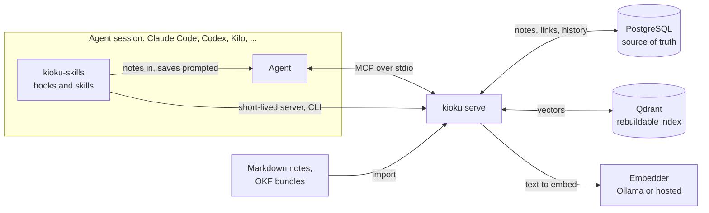

<h1 align="center">Kioku (記憶)</h1>

<p align="center"><b>Long-term memory for coding agents, served over MCP.</b></p>

<p align="center">
  <a href="https://github.com/Jpgomesf/kioku/actions/workflows/ci.yml"></a>
  <a href="LICENSE"></a>
  <a href="Cargo.toml"></a>
</p>

Kioku is a local-first memory server for coding agents. Agents save the
decisions, verified fixes, conventions and gotchas that the code can't show,
and find them again in later sessions through keyword, meaning and link
search. It runs on your machine and sends nothing out by default: a note
reaches a model only when an agent reads it, and vaults and locks decide which
model providers may read what.

<!-- Demo: a GIF or screenshot of an agent recalling a past decision in a new
session, with the Kioku Viewer's graph of the same notes beside it. -->

## Why Kioku

- **Agents forget between sessions.** A `CLAUDE.md` holds a few rules, old
  transcripts are too long to reread, and the reasons behind a choice get lost.
- **Curated beats extracted.** Kioku keeps short notes that a person confirmed
  or a test verified, one fact each. Published benchmarks found
  model-extracted memory weak at keeping facts current
  ([evidence](docs/design.md#why-not-let-a-model-build-the-graph)).
- **Memory should come to the agent.** Agents often skip an optional lookup,
  so the Claude Code plugin brings notes in at session start, with each prompt
  and when a file opens.
- **Measured, not assumed.** Ranking changes are scored on graded queries, and
  each number below comes with the command that reproduces it.

## Features

- **Hybrid retrieval with a link graph.** BM25 and vectors fused with
  Reciprocal Rank Fusion, exact labels first; curated links bring in the note a
  result builds on, without pushing direct matches down.
- **Works with any model.** Three core tools, flat schemas, short keys instead
  of UUIDs and errors that say what to fix, so quantized local models cope too.
- **Vaults and provider locks.** One vault per company or part of your life,
  chosen by folder or git remote; locks decide which providers may read what.
- **Plugins for Claude Code and Codex.** Hooks bring notes into every session
  and save what it settled; six skills save, check, sync, audit and tidy notes.
- **A code map for small local models.** Each file's purpose, definitions and
  neighbours, plus the decisions anchored to it.
- **An evaluation harness.** Retrieval scored with ablations and confidence
  intervals, and behavior checks that score what agents do with the tools.
- **Markdown and OKF import.** Keep notes as files you review, or import an
  Open Knowledge Format bundle as it is.
- **A desktop viewer (early).** [Kioku Viewer](viewer/README.md) browses notes,
  the link graph and vault access on macOS.

## Quick start

You need Docker with Compose, Rust 1.94 or newer, Python 3 (used once to
generate credentials) and, for the last step, Claude Code.

```sh
git clone https://github.com/Jpgomesf/kioku && cd kioku
make start      # PostgreSQL, Qdrant and Ollama on 127.0.0.1; writes a private .env
make install    # builds bin/kioku; on Apple Silicon, make install-prebuilt downloads CI's build instead
./bin/kioku doctor
claude mcp add --scope user kioku -e MEMORY_PROVIDER=anthropic -- "$PWD/scripts/mcp.sh"
```

Next, add the hooks and skills from
[kioku-skills](https://github.com/Jpgomesf/kioku-skills) so memory reaches
Claude unasked ([how](#claude-code-hooks-and-skills)). Other clients connect
the same way ([docs/clients.md](docs/clients.md)).

## How it works



A search scores every note in the domain with BM25 over its key, title,
aliases, tags and body, asks Qdrant for vector similarity, and fuses the two
rankings with Reciprocal Rank Fusion. Personalized PageRank from the top
matches then fills the last slot with a linked note, marked `linked_from`. The
server runs no language model: it returns short previews, and the agent reads
the one or two notes it needs within a byte budget.
[docs/design.md](docs/design.md#how-retrieval-works) has the details.

## Why PostgreSQL and Qdrant, not a graph database

- **PostgreSQL is the source of truth.** Notes, links, feedback, lifecycle and
  an append-only revision history, with transactions, constraints and plain
  backups. Each client's server writes through one advisory lock.
- **Qdrant is derived.** `kioku repair --all` rebuilds it, and `kioku reindex`
  moves to another embedding model in a new collection without touching
  PostgreSQL. pgvector would also work at this scale; Qdrant costs one more
  service.
- **The graph is small and curated.** Explicit `related` links, walked
  in-process. That needs no graph engine and no query language. The cost: no
  graph queries, and no bi-temporal facts like
  [Graphiti](https://github.com/getzep/graphiti)'s.
- **Model-built graphs don't pay off for recall.** In published benchmarks,
  plain BM25 kept updated facts better than Mem0 and Zep (48.0 against 18.0
  and 7.0 on single-hop questions;
  [Hu et al.](https://arxiv.org/abs/2507.05257)). Global GraphRAG answered 19%
  of unanswerable queries correctly against 96% for plain RAG
  ([Han et al.](https://arxiv.org/abs/2502.11371)). Microsoft's GraphRAG took
  115.5M input tokens to index 11,656 passages
  ([Gutiérrez et al.](https://arxiv.org/abs/2502.14802)).
- **When a graph store wins:** entities extracted from text at scale, facts
  with validity windows, or multi-hop traversal as the main workload. Even
  then, [Apache AGE](https://github.com/apache/age) adds Cypher to PostgreSQL.

The full rationale and its sources: [docs/design.md](docs/design.md).

## Results

Kioku's own retrieval set: 24 fictional notes and 40 graded queries in nine
categories (exact labels, identifiers, paraphrases, Portuguese and English,
multi-hop links, supersession, legacy history, distractors, abstention), k = 5,
`nomic-embed-text` through Ollama. Reproduce it in isolated storage with:

```sh
make eval
```

| Ranking | Recall@5 | MRR | nDCG@5 | Hit@1 | Packs with the answer (1,500 bytes) |
|---|---|---|---|---|---|
| Previous release (linear score with PageRank) | 0.773 | 0.544 | 0.541 | 0.222 | 14/32 |
| Vector only | 0.884 | 0.894 | 0.865 | 0.861 | |
| Hybrid (vector + BM25) | 0.935 | 0.958 | 0.919 | 0.861 | |
| **Hybrid + graph expansion (default)** | **0.958** | **0.958** | **0.928** | **0.861** | **31/32** |

The same run reports graph ablations, with 95% bootstrap intervals:

| Links | nDCG@5 (95% CI) | Multi-hop queries with every hop in the top 5 |
|---|---|---|
| Stored | 0.928 [0.854, 0.977] | 4/4 |
| None | 0.919 [0.842, 0.973] | 3/4 |
| Shuffled (5 seeds) | 0.919 [0.842, 0.973] | 75% |

- **Another model:** `./bin/kioku eval --embedding-model qwen3-embedding:0.6b --embedding-dim 1024`
  reaches recall 1.000, nDCG 0.975 and 32/32, mostly from better Portuguese
  and English matching.
- **In CI:** a weekly job reruns the set on a GitHub-hosted Linux runner (CPU)
  and fails below recall 0.93 or nDCG 0.90, on hub exposure above 3×, or on a
  leaked superseded note.
- **Not measured yet:** BM25 alone, a no-memory baseline (the
  [answer harness](evals/answers/README.md) is ready, with no published
  results), and Kioku's effect on coding tasks.
- **Caveats:** the set is small and synthetic, and its author also tuned the
  ranking, so treat the numbers as regression guards. Kioku hasn't run LoCoMo
  or LongMemEval. Method and per-category scores:
  [docs/evaluation.md](docs/evaluation.md).

## How it compares

Each cell for another project comes from its own README, checked on
2026-11-08.

| | Kioku | [basic-memory](https://github.com/basicmachines-co/basic-memory) | [Mem0](https://github.com/mem0ai/mem0) | [Graphiti](https://github.com/getzep/graphiti) (Zep) | [cognee](https://github.com/topoteretes/cognee) |
|---|---|---|---|---|---|
| Storage | PostgreSQL, plus a Qdrant index rebuilt from it | Markdown files and a SQLite index; Postgres optional | Hosted platform, or a self-hosted server | Neo4j, FalkorDB or Amazon Neptune | Relational, vector and graph stores; all three can share one Postgres (graph part is a demo) |
| Who writes memory | The agent, one confirmed fact at a time, or you in Markdown | You and the agent, as Markdown | An LLM extracts it from conversations | An LLM builds a graph from episodes | Extraction into entities and relationships |
| Runs fully offline | Yes, with the bundled Ollama | Yes, "air-gapped friendly" | Needs an LLM; OpenAI by default | Defaults to OpenAI; local models through Ollama | Yes: local extraction and embedding models, no API key |
| Graph | Curated links between notes | Wiki links in the Markdown | Entity linking across memories | Bi-temporal knowledge graph | Knowledge graph |
| Evals published | Retrieval on its own 24-note set, with ablations | None in its README | LoCoMo, LongMemEval and BEAM, for its managed platform | None in its README; see the Zep paper | BEAM |
| Agent integration | MCP server; Claude Code and Codex plugins | MCP server | SDKs, a CLI and agent skills | Reference MCP server | MCP server; Claude Code and Codex plugins |
| License | MIT | AGPL-3.0 | Apache-2.0 | Apache-2.0 | Apache-2.0 |

**When to choose which**

- **Kioku:** coding agents across many repositories that need the decisions
  and gotchas the code can't show, kept local, one vault per company or client.
- **basic-memory:** a knowledge base you read and write as Markdown files, in
  your editor or Obsidian, next to the AI.
- **Mem0:** memory about the users of your own AI application, extracted
  automatically, with a managed platform.
- **Graphiti or Zep:** facts that change over time and relationships between
  entities, on a graph database you run (Graphiti) or a managed service (Zep).
- **cognee:** turning documents and data into a knowledge graph to query.

**When not to use Kioku**

- You want everything captured from every conversation, unreviewed. Kioku
  saves what a session settled, and automatic capture needs Claude Code.
- Your questions are mostly multi-hop over entities, or about what was true
  when. A graph store fits better.
- You need a shared service for a team. Kioku serves each client over stdio, or
  over HTTP on loopback only.
- One project with a handful of rules. A `CLAUDE.md` or `AGENTS.md` is simpler.

## Using Kioku well

**Recall** before work that depends on earlier decisions. **Work** with notes
as evidence, and check the code when a value matters. **Save** once when the
user confirms a decision or a test proves a fix. **Maintain** now and then.
[docs/usage.md](docs/usage.md) has the details.

### Claude Code: hooks and skills

```sh
claude plugin marketplace add Jpgomesf/kioku-skills
claude plugin install kioku-memory@kioku-skills
claude plugin install kioku-hooks@kioku-skills
```

Both plugins find this checkout through `KIOKU_HOME`: set it in your shell
profile and under `env` in `~/.claude/settings.json`. The hooks:

| When | What happens |
|---|---|
| Session start | The session's vault and area, its newest notes, what background reviews saved, and the items waiting for your decision |
| Each prompt | Notes for IDs the prompt names, and up to three notes it is about, each once per session |
| Opening a file | The notes anchored to that file through `paths`, and knowledge-base notes about it |
| After a commit, or every 8 prompts | Claude is asked to save what that stretch settled; a commit also updates the code map |
| Compaction and session end | A background Sonnet reviews the transcript and saves what qualifies |

The skills:

| Skill | Use it when | Example |
|---|---|---|
| `checkpoint` | Before you compact or end a session, or when you say "remember this" | `/kioku-memory:checkpoint the retry decision` |
| `decide` | A design, data-model, tooling or convention choice comes up | `/kioku-memory:decide which amount refund retries charge` |
| `memory-refresh` | A note turns out stale, or before you rely on notes older than a refactor | `/kioku-memory:memory-refresh work/payments` |
| `project-sync` | A project's notes are behind its commits, PRs and threads, or it has none | `/kioku-memory:project-sync personal/notes dry-run` |
| `reflect` | You want a health check, or an audit for contradictions that changes nothing | `/kioku-memory:reflect work/payments health` |
| `dream` | An area's notes need splitting, merging, linking and one hub per topic | `/kioku-memory:dream personal/notes` |

What each skill saves at once and what waits for you:
[docs/usage.md](docs/usage.md#which-skill-when).

### Codex, other clients and local models

- **Codex** installs `kioku-memory` from the same marketplace
  (`codex plugin marketplace add Jpgomesf/kioku-skills`, then `/plugins`).
  `checkpoint`, `decide` and `memory-refresh` work there; the other three
  skills and the hooks need Claude Code.
- **Other clients** get the memory policy from the server's instructions.
  Without vaults, name each project's domain in its `AGENTS.md`:
  `The Kioku memory domain for this project is my-project.`
- **Small local models** rarely search on their own, so push memory to them:
  the code map (`scripts/mcp.sh --tools core,code_map`) for each file they
  read, and a context pack (`kioku context "<prompt>"`) for each prompt
  ([docs/usage.md](docs/usage.md#small-local-models)).

### Tool habits

- Follow `memory_search`'s `next` field: it names the `memory_get` call for
  the best one or two results.
- Pass `"count_use": false` when reading only to compare or audit, so unused
  notes still age.
- When a reply says `truncated`, raise `max_bytes` (default 2,000, up to
  8,000) or ask for fewer keys.
- A save replaces `aliases`: send `memory_get`'s list plus the new alias.
- Anchor decisions to code with `paths` globs; `memory_list {"path": ...}`
  lists a file's notes.
- Audit with `memory_list` (filter by `origin`, `tag`, `status` or `path`) and
  `memory_inspect`. Retire only with the user's go-ahead; `memory_restore`
  reverses it.

### Notes that are easy to find

- One fact per note, under a stable kebab-case key, subject first.
- A title that states the claim, aliases for every ID people search for, and
  one kind tag such as `decision`, `convention` or `gotcha`.
- A body of one to three sentences: the fact, why it holds, where it applies,
  and for a decision, the options rejected.
- One to three `related` links in the same domain. Never descriptions of code,
  progress, transcripts or secrets.

### Keeping memory healthy

- `/kioku-memory:reflect <domain> health` monthly, with a retrieval dataset per
  area to catch regressions.
- The pending list holds what waits for your decision; session start shows it.
- A weekly scheduled `dream` keeps areas tidy.
- Nothing ages on its own. `kioku maintenance --dry-run` previews which stale,
  unpinned notes would move to legacy, and `kioku pin` protects a note.

## Reference

| Tool | Profile | What it does |
|---|---|---|
| `memory_search` | core | Ranked previews (key, title, snippet, score) for a question |
| `memory_get` | core | Full text of chosen notes by key, with aliases and links, within a byte budget |
| `memory_save` | core | Create or update one note by key, optionally anchored to code `paths`; refuses credentials and file-backed notes |
| `memory_inspect` | all | Aliases, provenance, lifecycle, usage, links, and recent history of one note |
| `memory_list` | all | Page through a domain's notes, filtered by status, origin, tag, or anchored file |
| `memory_feedback` | all | Record that a note proved right or wrong |
| `memory_retire` / `memory_restore` | all | Move a note to legacy and back; nothing is deleted |
| `memory_import` | all | Import Markdown notes from `MEMORY_NOTES_ROOT` |
| `memory_maintenance` | all | Preview or apply aging |
| `memory_stats` | all | Counts by status and domain, index health |
| `code_map` | all | A source file's purpose, definitions and neighbours, for small local models |

`core` is the default. `MEMORY_TOOLS=all` (or `scripts/mcp.sh --tools all`)
adds the rest, and a list such as `core,memory_import` picks tools. Two MCP
prompts, `recall` and `remember`, are shortcuts in clients that support them,
and tools from earlier versions (`rag_search`, `rag_context`, `memory_upsert`,
...) still work under their old names.

```sh
./bin/kioku ingest --path examples/notes --domain demo   # try it with the example notes
./bin/kioku search "Which service replaces the old indexing worker?" --domain demo
./bin/kioku doctor                 # check services and embeddings
./bin/kioku stats                  # counts and pending index work
./bin/kioku repair [--all]         # re-index missing (or all) vectors
./bin/kioku maintenance --dry-run  # preview aging; without --dry-run, apply it
./bin/kioku pin KEY --domain D     # protect a note from aging
./bin/kioku reindex --embedding-model qwen3-embedding:0.6b --embedding-dim 1024 --collection local_memory_v2
```

`reindex` embeds every note into a new collection, switches the database to
it, and prints the settings to put in `.env`; close MCP clients first.
`./bin/kioku --help` lists every command.

| Topic | Where |
|---|---|
| Using Kioku well: hooks, skills, tool habits, note writing, upkeep | [docs/usage.md](docs/usage.md) |
| Connecting each client, tool profiles, local models | [docs/clients.md](docs/clients.md) |
| Services, embeddings on the Apple GPU or a hosted service, every variable | [docs/configuration.md](docs/configuration.md) |
| Vaults, areas, placement and provider locks | [docs/vaults.md](docs/vaults.md) |
| Scopes, domain patterns and the local HTTP transport | [docs/access-control.md](docs/access-control.md) |
| The note format and OKF bundles | [docs/notes.md](docs/notes.md) |
| The code map | [docs/code-map.md](docs/code-map.md) |
| Retrieval, storage choices and their evidence | [docs/design.md](docs/design.md) |
| Evaluation method and results | [docs/evaluation.md](docs/evaluation.md) |

## Limitations and status

- **Version 0.2.** The tool contract is snapshot-tested and older tool names
  keep working, but expect changes before 1.0.
- **Platforms.** The prebuilt binary is for macOS on Apple Silicon only;
  elsewhere `make install` compiles. CI tests on Linux; Windows is untested.
- **Scale.** A domain holds at most 10,000 notes. Each server process indexes a
  domain on its first search there and reuses the index after that: a warm
  search takes 10 to 16 ms from 1,000 to 100,000 notes (the benchmark lifts the
  limit), but the first search in a new process, which is what a hook gets,
  takes 26 ms at 1,000 notes and 1.8 s at 100,000
  ([docs/evaluation.md](docs/evaluation.md#scale)).
- **Note size.** A note must fit the embedding model's context window, about
  6 KB of English text for `nomic-embed-text`. OKF imports split long concepts.
- **Client reach.** The hooks and three of the six skills need Claude Code. The
  viewer is an unreleased 0.1, built from source.

## FAQ

**What leaves my machine?** With the default local embedder, nothing that
Kioku sends: the services listen on 127.0.0.1 and the server runs no language
model. A hosted embedder receives the notes its provider may read
([docs/configuration.md](docs/configuration.md#hosted-embeddings)). Your
agent's model provider sees the notes the agent reads, and vaults and locks
decide which providers may. The kioku-hooks review runs `claude -p`, so it
reads transcripts with the same provider as your Claude Code session.

**Can I change the embedding model?** Yes. Compare one on the bundled set, or
your own, with `kioku eval --embedding-model <name> --embedding-dim <size>`,
then move with `kioku reindex`, which keeps the old collection for rollback.

**How do I back it up?** Back up PostgreSQL, which holds the notes, links,
history and feedback, together with any Markdown notes. The Qdrant index is
derived; `kioku repair --all` rebuilds it.

**Which clients work?** Any MCP client that starts a stdio server;
[docs/clients.md](docs/clients.md) covers Claude Code, Codex, Kilo, Gemini CLI,
Qwen Code and Cursor. Others can use [local HTTP](docs/access-control.md#local-http).

## Contributing

```sh
make check   # fmt, clippy with warnings denied, unit and contract tests
make test-db # PostgreSQL tests (history, aging, store); MEMORY_TEST_DATABASE_URL must allow CREATE DATABASE
make smoke   # 167 checks over stdio and 20 over HTTP; SMOKE_ENV must name test storage
make eval    # retrieval quality in isolated storage
```

The model-facing contract (tool names, schemas, descriptions, annotations,
instructions) is snapshot-tested in `tests/snapshots/`; changing it is a
deliberate `KIOKU_BLESS=1 cargo test`. CI runs formatting, clippy and tests
with and without the HTTP feature, the minimum Rust version, cargo-deny, and
the smoke tests against real PostgreSQL and Qdrant. The viewer has its own
checks: `make viewer-check`.

## Security

Memory text is untrusted input: results are labelled as evidence, never
instructions, and the server never builds its tool catalog from stored data.
See [SECURITY.md](SECURITY.md) for the threat model and how to report issues.

## License

[MIT](LICENSE)
